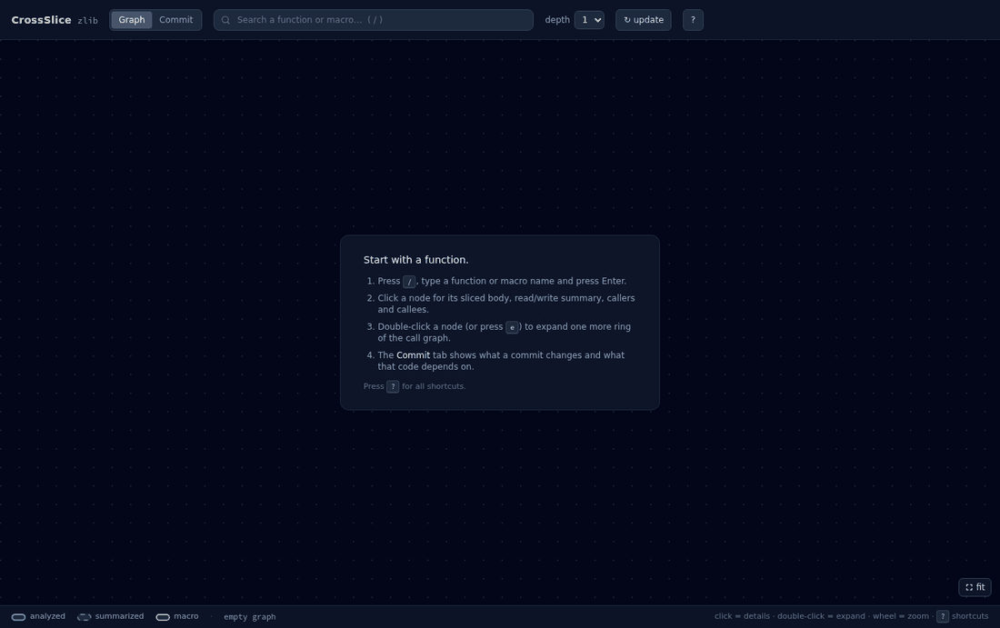

# CrossSlice

Demand-driven context retrieval for commit and code comprehension in C.

CrossSlice shows the code that changes depend on: the
statements of the same function that are connected to the change by a def-use
chain, the called functions sliced to what the change passes to them, the
callers with their call sites, and the macros the change uses. It works on a
plain checkout, without building the project, and answers in seconds on
repositories the size of FFmpeg or php-src.

It has two modes:

- **Commit context.** For a commit, the change merged with its def-use slice in
  both versions, with the callees, callers and macros it touches.
- **Code context.** For a function or a `file:line`, the enclosing function,
  its read/write summary, callees, callers, the types it uses and the slice
  around that line.

and three interfaces: a command line, a graph explorer in the browser or in
VS Code, and a Model Context Protocol (MCP) server for coding agents.

Status: research prototype, C only. A tool paper describing the design and
the evaluation is under submission. The evaluation harness, the case files
and every result behind the paper's numbers are in [`eval/`](eval/README.md).



## How it works

1. **Intra-procedural slice.** Both versions of a changed file are parsed with
   tree-sitter into a statement-level IR with def/use sets. Variables are
   recorded as access paths in addition to plain identifiers, so a write to
   `s->gb.x` is kept apart from a write to `s->count`. Array indices and
   pointer aliases are not distinguished. GumTree classifies the statements
   as unchanged, inserted, deleted, modified or moved, and a bidirectional
   def-use slice keeps the statements connected to the change.
2. **Call targets without a build.** The call targets of the relevant
   statements are resolved by a cascade: GNU Global proposes definitions,
   tree-sitter checks that a definition spans the candidate and that its
   parameter count matches the call, clangd decides the remaining ambiguous
   cases with a compile database taken from the project or synthesized, and a
   ranked fallback picks the rest and marks it as such. Callees are sliced to
   the arguments and the return value of the call and summarized by the
   parameters they read and write; callers are found through the references
   Global reports.
3. **Repository graph.** The explorer and the MCP server work on a SQLite
   graph of functions, macros and call edges that grows by one ring per query,
   lives in `~/.cache/crossslice/` and is updated incrementally by file
   content hash.

## Install

Requirements: Python 3.10 or newer, git, GNU Global (`gtags`, `global`),
Java 17 or newer with GumTree 4.0.0-beta3, and optionally clangd and gcc.
The [Docker image](#docker) contains all of them, so with Docker this section
can be skipped.

```bash
git clone https://github.com/UzL-ITS/CrossSlice.git
cd CrossSlice
```

The external tools on Debian or Ubuntu:

```bash
sudo apt-get update
sudo apt-get install -y global clangd gcc openjdk-21-jre-headless unzip curl
curl -sSL -o /tmp/gumtree.zip https://github.com/GumTreeDiff/gumtree/releases/download/v4.0.0-beta3/gumtree-4.0.0-beta3.zip
sudo mkdir -p /opt/gumtree && sudo unzip -q /tmp/gumtree.zip -d /opt/gumtree
```

On RHEL or CentOS 9, `sudo bash scripts/setup_tools.sh` installs them. On
macOS, run `brew install global llvm openjdk` and unpack the
[GumTree release](https://github.com/GumTreeDiff/gumtree/releases/tag/v4.0.0-beta3)
into `~/gumtree`. GumTree is found in `/opt/gumtree` and `~/gumtree`;
elsewhere, set `GUMTREE_PATH` to its `bin/gumtree`.

The `crossslice` command is installed with
[uv](https://docs.astral.sh/uv/getting-started/installation/):

```bash
uv tool install .
crossslice check                        # verifies the external tools
```

If the shell does not find `crossslice` afterwards, run `uv tool update-shell`
and open a new shell.

## Quick start

CrossSlice needs no configuration. Run it inside a git checkout of a C project
and it analyzes that repository.

```bash
bash examples/kvstore-evolution/init.sh      # a small repository with a buffer overflow and its fix
cd examples/kvstore-evolution/kvstore
crossslice enrich                            # commit context of HEAD
crossslice context kv.c:70 --slice           # code context of a line
crossslice expand kv_put                     # callees and callers of a function
crossslice explore --open                    # the explorer in the browser
```

`crossslice explore` prints the address of the explorer, by default
`http://127.0.0.1:8000/`. On a remote machine, forward that port, for example
with `ssh -L 8000:127.0.0.1:8000 user@host`, and open the address in the local
browser.

[examples/README.md](examples/README.md) describes the two bundled example
projects and the expected output.

## Commands

| Command | What it does |
|---|---|
| `crossslice enrich [REV]` | commit context of REV (default HEAD) against its parent; `--parent REV2` for another base, `--no-cross` for the intra-procedural slice only |
| `crossslice context FILE:LINE` | the function containing the line, its read/write summary, callees as one-line summaries, callers with call sites and the types it uses; `--slice` adds the def-use slice around the line |
| `crossslice expand FUNCTION` | callers and callees with summaries; `--levels N`, `--direction up` or `down`, `--dot FILE` |
| `crossslice explore` | the explorer, with a commit tab for the commit context of recent commits; `--open` opens the browser |
| `crossslice mcp` | the MCP server over stdio |
| `crossslice dataset JSONL` | commit context for a list of commits, one file per commit |
| `crossslice graph update` / `stats` | refresh or inspect the cached graph |
| `crossslice check` | checks the external tools and shows the cache location |

Every command accepts `-C DIR` to analyze another directory and `--cache-dir
DIR`. The analysis commands accept `--rev REV` to analyze a past revision in a
temporary worktree. CrossSlice writes nothing into the analyzed checkout.
[USAGE.md](USAGE.md) documents the commands, the explorer, the VS Code
extension, the MCP setup and Docker in detail.

## Python

```python
from crossslice import RepoGraph, enrich_commit

g = RepoGraph("/path/to/repo")             # or RepoGraph(repo, commit="HEAD~3")
g.expand("mp_decode_layer3", levels=1)
hood = g.neighborhood("mp_decode_layer3")  # the function, its callees and callers with summaries
g.update()                                 # incremental update after the repository changed
g.close()

res = enrich_commit("/path/to/repo", "HEAD")
print(res.text, res.functions)
```

## VS Code

The extension in [vscode/](vscode/) shows the explorer in a panel, offers
*Context for Symbol Under Cursor* in C files, and shows the commit context of a
revision as a document. It starts the backend itself, with the local
`crossslice` command or the Docker image.

Building the extension needs Node.js 20 or newer, and it runs in VS Code 1.101
or newer:

```bash
cd vscode && npm install && npm run package      # crossslice-0.1.0.vsix
code --install-extension crossslice-0.1.0.vsix
```

Without Node.js, the same build runs in a container, from the root of the
checkout:

```bash
docker run --rm -u "$(id -u):$(id -g)" -e HOME=/tmp -v "$PWD/vscode:/w" -w /w node:22-slim sh -c "npm install && npm run package"
code --install-extension vscode/crossslice-0.1.0.vsix
```

If no `crossslice` command is installed, the extension uses the Docker image
`crossslice` (see [Docker](#docker)) and needs nothing else.

Then open the folder of a C repository in VS Code. The status bar item
`CrossSlice` opens a menu with *Commit Context*, *Open Explorer*, *Context for
Symbol Under Cursor*, and *Add MCP Server for Agents…*. While the backend
runs, every C function carries the lenses *CrossSlice context* and *show in
explorer*. [vscode/README.md](vscode/README.md) lists the commands and the
settings.

## Agents

```bash
cd /path/to/repo
claude mcp add crossslice -- crossslice mcp
```

The server answers for the files on disk by default and for any revision and
its parent on request. Its tools return sliced bodies, read/write summaries,
callers with call sites and one-call neighborhoods instead of whole files.
[docs/INTERFACE.md](docs/INTERFACE.md) is the contract.

## Docker

The image contains every external tool, so only Docker or Podman is needed.

```bash
git clone https://github.com/UzL-ITS/CrossSlice.git && cd CrossSlice
docker build -t crossslice .
docker run --rm -p 127.0.0.1:8000:8000 crossslice      # the explorer on a bundled example, http://127.0.0.1:8000/
```

For any checkout, mount it at `/repo` and keep the caches in a volume. With
the example repository of the quick start:

```bash
bash examples/kvstore-evolution/init.sh      # creates the repository, needs only git
cd examples/kvstore-evolution/kvstore
alias crossslice='docker run --rm -i -u "$(id -u):$(id -g)" -v "$PWD:/repo" -v crossslice-cache:/cache crossslice'
crossslice enrich                            # commit context of HEAD
crossslice context kv.c:70 --slice
crossslice expand kv_put
docker run --rm -p 127.0.0.1:8000:8000 -u "$(id -u):$(id -g)" -v "$PWD:/repo" -v crossslice-cache:/cache crossslice explore
```

`-p 127.0.0.1:8000:8000` publishes the explorer on the local interface only.
On a remote machine, forward the port as shown in the
[quick start](#quick-start). On SELinux hosts (Fedora, RHEL), add
`--security-opt label=disable` to the `docker run` commands.
[USAGE.md](USAGE.md#docker) describes the MCP server through Docker and how to
remove the image and its caches.

## Limitations

C only. The def-use slice follows the source order instead of the control
flow and does not distinguish array indices or pointer aliases. Calls through
function pointers are not followed. Macros are shown with their definitions,
not expanded. Symbols without a definition in the repository, such as libc
functions, are reported as unresolved.

## Development

```bash
uv run pytest -q                                   # unit tests
cd frontend && npm install && npm run dev          # explorer UI with live reload (proxies /api to :8000)
cd frontend && npm run build                       # regenerates crossslice/cross/webui/
```

## Citation and license

See [CITATION.cff](CITATION.cff). Apache 2.0, see [LICENSE](LICENSE) and [NOTICE](NOTICE).
